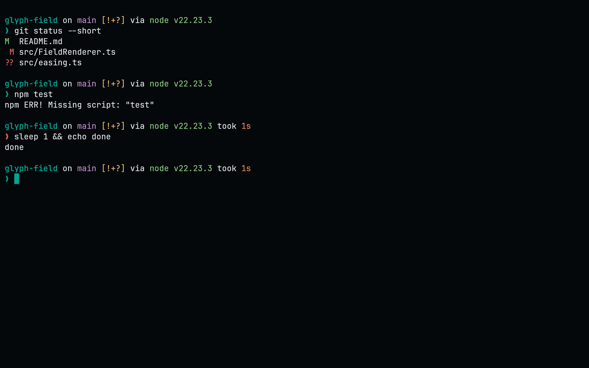
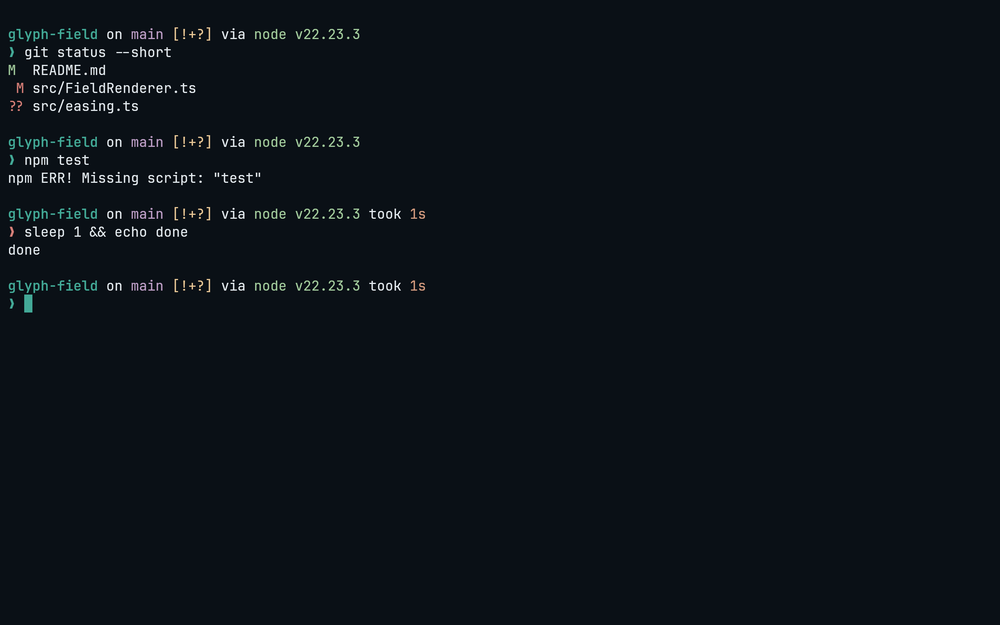
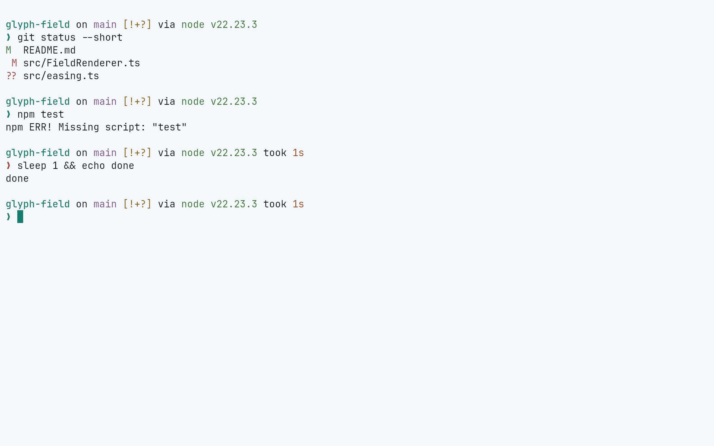
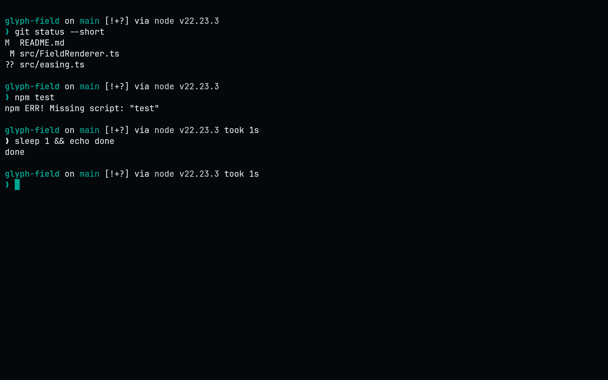

<!-- living-code-readme:1 -->
# 🌟 Living Code for Starship

**Calm slate. Living color.** Living Code for Starship. Repository-owned theme files, installation instructions and four color flavors.

[Installation](#installation) · [Flavors](#flavors) · [Configuration](#configuration) · [All ports](https://github.com/living-code-theme)

## Previews

<table data-lc-flavors>
<tr>
<td width="50%" valign="top">
<strong>Night</strong><br><sub>Dark · full palette</sub><br><br>
<a href="images/night.png"></a>
</td>
<td width="50%" valign="top">
<strong>Frost</strong><br><sub>Dark · softer chroma</sub><br><br>
<a href="images/frost.png"></a>
</td>
</tr>
<tr>
<td width="50%" valign="top">
<strong>Paper</strong><br><sub>Light · near-white slate</sub><br><br>
<a href="images/paper.png"></a>
</td>
<td width="50%" valign="top">
<strong>Signal</strong><br><sub>Dark · teal accent</sub><br><br>
<a href="images/signal.png"></a>
</td>
</tr>
</table>

Select any preview to view the image at full size.

## Installation

Starship needs the `palette = ...` line at the top of the file and the palette table after your own settings, so this puts each in place. It is safe to run again with another `flavor=`: it first removes the `palette` line and any earlier Living Code palette table, and keeps everything else (a `palette` line you set yourself is replaced too). If `starship.toml` is a symlink (home-manager, GNU stow, chezmoi), the link is followed and its target is edited, so the link stays in place; if the target is read-only it stops and changes nothing. Starship reads `$STARSHIP_CONFIG` or `~/.config/starship.toml`, not `XDG_CONFIG_HOME`:

```sh
flavor=night
cfg="${STARSHIP_CONFIG:-$HOME/.config/starship.toml}"
mkdir -p "$(dirname "$cfg")"; t="$cfg"; n=0; while [ -L "$t" ] && [ "$n" -lt 40 ]; do n=$((n+1)); l="$(readlink "$t")"; case "$l" in /*) t="$l" ;; *) t="$(dirname "$t")/$l" ;; esac; done
if [ -L "$t" ]; then echo "$cfg is a symlink loop (more than 40 links), so it was left unchanged." >&2; false; elif [ -e "$t" ] && [ ! -w "$t" ]; then echo "$t is read-only, so it was left unchanged. Add the Living Code palette to its source instead." >&2; false; else touch "$t" && p="$(curl -fsSL "https://raw.githubusercontent.com/living-code-theme/starship/main/living-code-$flavor.toml")" && { printf '%s\n' "$p" | head -n 1; awk 'BEGIN{top=1} /^\[/{top=0; skip=($0 ~ /^\[palettes\.living_code_/)} skip{next} top && /^palette[ \t]*=/{next} /^[ \t]*$/{n++; next} {for(;n>0;n--) print ""; print}' "$t"; printf '\n'; printf '%s\n' "$p" | tail -n +2; } > "$t.new" && cat "$t.new" > "$t" && rm "$t.new"; fi
```

Module styles can then use names like `"bold teal"` or `"amber"`.

## Flavors

Expand a flavor for its full-size preview and activation instructions.

<details data-lc-flavor="night">
<summary><strong>Night</strong> · Dark · full palette</summary>

<p><a href="images/night.png"></a></p>

Use `flavor=night` in the installation command. It places this setting before the palette table without removing your other configuration:

```toml
palette = "living_code_night"
```

</details>

<details data-lc-flavor="frost">
<summary><strong>Frost</strong> · Dark · softer chroma</summary>

<p><a href="images/frost.png"></a></p>

Use `flavor=frost` in the installation command. It places this setting before the palette table without removing your other configuration:

```toml
palette = "living_code_frost"
```

</details>

<details data-lc-flavor="paper">
<summary><strong>Paper</strong> · Light · near-white slate</summary>

<p><a href="images/paper.png"></a></p>

Use `flavor=paper` in the installation command. It places this setting before the palette table without removing your other configuration:

```toml
palette = "living_code_paper"
```

</details>

<details data-lc-flavor="signal">
<summary><strong>Signal</strong> · Dark · teal accent</summary>

<p><a href="images/signal.png"></a></p>

Use `flavor=signal` in the installation command. It places this setting before the palette table without removing your other configuration:

```toml
palette = "living_code_signal"
```

</details>

## Configuration

See [Starship's documentation](https://starship.rs) for application settings and reload behavior. The activation instructions above identify each supported flavor; keep your other application configuration.

## Compatibility

This port supplies theme files for Starship, not the application itself. Install the application separately and follow the installation instructions for its supported configuration format.

## Contributing

Found a problem? [Open an issue](https://github.com/living-code-theme/starship/issues/new/choose) with the app version, the flavor and a screenshot. Want Living Code somewhere else? [Request a port](https://github.com/living-code-theme/core/issues/new?template=port-request.yml).

Pull requests are welcome. Keep this README, `port.json` and `images/` in sync, and use real screenshots of the app, never mockups.

🦎 **One chameleon, many habitats.** Part of [Living Code](https://github.com/living-code-theme).

## License

[MIT](LICENSE) © Elliot Luque
